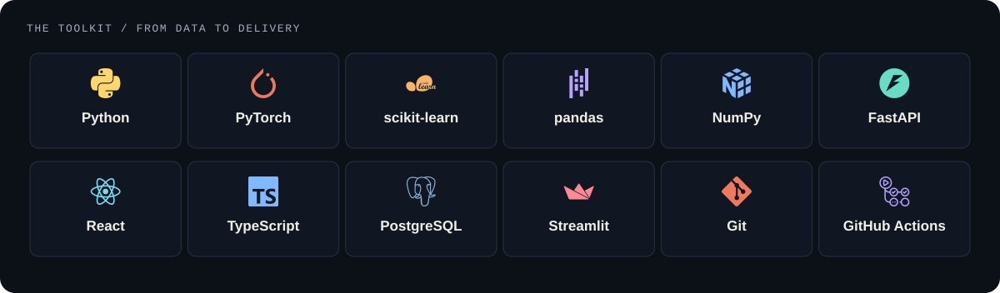

<picture>
  <source media="(prefers-reduced-motion: reduce)" srcset="assets/static/hero.svg">
  
</picture>

  <a href="#selected-work">Selected work</a> &nbsp; / &nbsp;
  <a href="#how-i-work">How I work</a> &nbsp; / &nbsp;
  <a href="#tech-stack">Tech stack</a> &nbsp; / &nbsp;
  <a href="mailto:saifshahzad901@gmail.com?subject=Project%20inquiry%20from%20GitHub">Start a conversation ↗</a>

# I'm Saif. I turn complex data into useful tools.

**Data Science @ FAST-NUCES, Islamabad · Applied AI · Machine Learning**

I like the space where a good experiment becomes something someone can use. My work spans document intelligence, custom transformers, explainable machine learning, and temporal graph research, with interfaces that make the results easier to inspect.

**Have documents to process, patterns to uncover, or an AI idea to test?** Let's turn the problem into a clear first experiment, then build from the evidence.

**[Discuss a project ↗](mailto:saifshahzad901@gmail.com?subject=Project%20inquiry%20from%20GitHub)** &nbsp; · &nbsp; [Try my live application](https://invoice-intelligence-theta.vercel.app/) &nbsp; · &nbsp; [Explore my repositories](https://github.com/Saif1Shahzad?tab=repositories)

 

## Selected work

Four ways I explore the distance between raw data and a useful decision.

<table>
<tr>
<td width="50%" valign="top">

<a href="https://github.com/Saif1Shahzad/invoice-intelligence"><picture><source media="(prefers-reduced-motion: reduce)" srcset="assets/static/project-invoice.svg"></picture></a>

### Invoice Intelligence

**From a document to a record you can verify.**

PDFs, scans, and receipts become structured data through OCR and AI extraction. Source evidence, validation checks, human confirmation, and Excel exports complete the workflow.

Python · FastAPI · React · TypeScript · PostgreSQL

**[Try the live pilot ↗](https://invoice-intelligence-theta.vercel.app/)** &nbsp; · &nbsp; [Read the code](https://github.com/Saif1Shahzad/invoice-intelligence)

</td>
<td width="50%" valign="top">

<a href="https://github.com/Saif1Shahzad/AI-Review-Analysis-with-Custom-Transformers-and-RAG"><picture><source media="(prefers-reduced-motion: reduce)" srcset="assets/static/project-transformers.svg"></picture></a>

### Review Understanding + RAG

**What does a review say, and what supports the explanation?**

A custom transformer encoder learns review labels and embeddings. Retrieval finds related examples; a decoder generates explanations. A RAG versus no-RAG ablation examines the contribution of retrieval.

PyTorch · Custom transformers · Embeddings · Retrieval

**[Explore the experiment ↗](https://github.com/Saif1Shahzad/AI-Review-Analysis-with-Custom-Transformers-and-RAG)**

</td>
</tr>
<tr>
<td width="50%" valign="top">

<a href="https://github.com/Saif1Shahzad/dmt-gnn-aml"><picture><source media="(prefers-reduced-motion: reduce)" srcset="assets/static/project-graph.svg"></picture></a>

### Temporal Graph Learning for AML

**Follow the transfers. Preserve the sequence.**

Research on directed multigraphs, temporal attention, and recurrent memory for financial transaction analysis. Streaming replay studies the trade-off between information freshness and detection quality.

PyTorch · Temporal GNNs · Streaming replay · Reproducibility

**[Inspect the research ↗](https://github.com/Saif1Shahzad/dmt-gnn-aml)**

In progress: pipeline verified on synthetic fixtures; full benchmark evaluation pending. Joint research with Shahoud Shahid.

</td>
<td width="50%" valign="top">

<a href="https://github.com/Saif1Shahzad/cardioai-heart-disease-prediction"><picture><source media="(prefers-reduced-motion: reduce)" srcset="assets/static/project-cardio.svg"></picture></a>

### CardioAI

**A prediction is a starting point for understanding.**

An educational heart disease modeling study connecting data preparation, classifier comparisons, SHAP analysis, and a Streamlit dashboard prototype. Includes clustering and separate neural network experiments.

scikit-learn · XGBoost · SHAP · Streamlit

**[Explore the analysis ↗](https://github.com/Saif1Shahzad/cardioai-heart-disease-prediction)**

Educational portfolio prototype.

</td>
</tr>
</table>

<strong>A few more threads worth pulling ↗</strong>

 

- **[Urdu NLP](https://github.com/Saif1Shahzad/Urdu-NLP-Pipeline-Word-Embeddings-NER-and-Text-Classification)** — Word embeddings, BiLSTM sequence labeling, named entity recognition, and transformer classification.
- **[From Clicks to Loyalty](https://github.com/Saif1Shahzad/clicks-to-loyalty-data-mining)** — Customer intelligence through FP-Growth, RFM segmentation, and sequential pattern mining.
- **[Pulse to Prediction](https://github.com/Saif1Shahzad/pulse-to-prediction)** — Patient-vitals time series, dynamic time warping similarity search, and diagnosis classification.

 

## How I work

<picture>
  <source media="(prefers-reduced-motion: reduce)" srcset="assets/static/approach.svg">
  
</picture>

**Start with the decision.** What needs to become easier, clearer, or faster? That question shapes the data, the model, and the interface.

**Make the evidence inspectable.** I care about baselines, explanations, and the difference between a promising prototype and a verified result. You can see that in the source-linked invoice review, retrieval ablations, and documented research protocols above.

**Connect the pieces.** Data preparation, modeling, APIs, and interfaces belong to the same conversation. The goal is a tool someone can understand and use.

<strong>The small details that make a tool worth trusting ↗</strong>

 

- **Evidence beside the answer.** In [Invoice Intelligence](https://github.com/Saif1Shahzad/invoice-intelligence), extracted fields link back to their source. A person confirms the record before export.
- **The second click matters, too.** The invoice workflow accounts for repeated uploads, duplicate findings, and stale edits, so retries and concurrent work have explicit handling.
- **Time is part of the data.** In [DMT-GNN AML](https://github.com/Saif1Shahzad/dmt-gnn-aml), an event is scored before it updates memory. Histories exclude future events; preprocessing uses training data.
- **A result needs its context.** The [review understanding experiment](https://github.com/Saif1Shahzad/AI-Review-Analysis-with-Custom-Transformers-and-RAG) compares RAG with no RAG. Research progress, completed checks, and pending evaluation are documented separately.

 

## Tech stack

From the first notebook to the API, interface, and deployment.

<picture>
  <source media="(max-width: 600px)" srcset="assets/tech-stack-mobile.svg">
  
</picture>

| Focus | Tools and methods I've used |
| :--- | :--- |
| **Data & modeling** | [Python](https://www.python.org/) · [pandas](https://pandas.pydata.org/) · [NumPy](https://numpy.org/) · [scikit-learn](https://scikit-learn.org/) · XGBoost · [PyTorch](https://pytorch.org/) |
| **Language & intelligence** | Transformers · RAG · Embeddings · OCR · LLM APIs · SHAP |
| **Applications & delivery** | [FastAPI](https://fastapi.tiangolo.com/) · [React](https://react.dev/) · [TypeScript](https://www.typescriptlang.org/) · [Streamlit](https://streamlit.io/) · [PostgreSQL](https://www.postgresql.org/) · Vercel |
| **Experiments & verification** | Jupyter · Model comparisons · Ablation studies · Regression tests · [GitHub Actions](https://github.com/features/actions) |

 

## Let's build something useful

I'm open to **project work, research collaborations, and building with people who care about the details.**

Bring me a document workflow that needs less manual work, a dataset with an unanswered question, or an AI idea that needs a prototype. Tell me **what you're trying to achieve, what you have so far, and your timeline**. That's enough to start.

<a href="mailto:saifshahzad901@gmail.com?subject=Project%20inquiry%20from%20GitHub"><picture><source media="(prefers-reduced-motion: reduce)" srcset="assets/static/contact.svg"></picture></a>

  <strong><a href="mailto:saifshahzad901@gmail.com?subject=Project%20inquiry%20from%20GitHub">saifshahzad901@gmail.com</a></strong>
   
  Based in Islamabad, Pakistan · Open to remote collaboration

